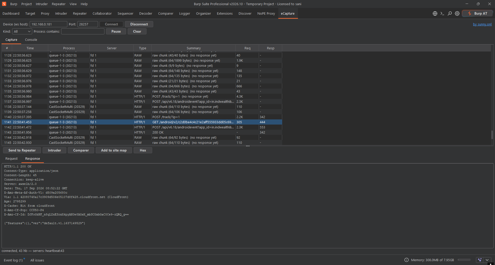

# eCapture for Burp Suite

A Burp Suite extension that gives [eCapture](https://github.com/gojue/ecapture) a graphical
interface inside Burp. It connects to eCapture's eCaptureQ WebSocket stream, rebuilds the captured
TLS plaintext from Android apps into HTTP/1.x and HTTP/2 requests and responses, and lists them in
a Burp tab, from where you can send any of them to Repeater, Intruder, Comparer or the site map.

Created by **Sunny** - [sunny.onl](https://sunny.onl)



## What this is (and is not)

- **This plugin only gives eCapture a GUI.** All of the actual capturing is done by eCapture,
  which hooks the TLS library on a rooted device with eBPF and reads the plaintext before it is
  encrypted / after it is decrypted. The plugin does not capture, decrypt or bypass anything by
  itself; it reads what eCapture already outputs and makes it usable in Burp.
- **It works, but not for every Android app or every request.** You will see the traffic that
  passes through the TLS library eCapture hooks (typically apps using the system
  OpenSSL/BoringSSL, such as OkHttp / Conscrypt based apps). Expect gaps:
  - apps that ship their own TLS stack (e.g. Flutter, Cronet, Go or Rust networking, many games)
    may not show up at all;
  - apps that add their own encryption on top of TLS will show requests, but the bodies stay
    encrypted;
  - some connections can only be shown as **RAW** chunks when they cannot be reassembled
    (for example traffic that started before capture began, or non-HTTP protocols).

  In practice, the less protected requests of an app are visible; well-hardened traffic often
  is not.

## Requirements

- Burp Suite 2025.x or newer (Community or Professional).
- A rooted Android device (arm64) with eCapture on it. Tested with eCapture **v2.7.0**
  (`ecapture-v2.7.0-android-arm64` from the
  [eCapture releases](https://github.com/gojue/ecapture/releases)); the newer v2.8+ event format
  is supported as well.
- To build from source: JDK 17+ on Windows (`build.bat`).

## Installing

Download `eCapture-burp.jar` from this repository's Releases page (or build it, see below), then in
Burp: **Extensions** → **Installed** → **Add** → Extension type *Java* → select the jar.
A new tab named **eCapture** appears.

## Usage

With `--ecaptureq`, eCapture runs a WebSocket **server on the device** and the plugin connects to
it. Always use text mode (`-m text`) and do not add `--hex`.

### Wi-Fi (device and PC on the same network)

1. On the device (as root):
   ```
   /data/local/tmp/ecapture tls -m text --ecaptureq=ws://0.0.0.0:28257/
   ```
2. In the eCapture tab set *Device (ws host)* to the **device's** IP address, port `28257`, and
   click **Connect**.

### USB

1. On the PC: `adb forward tcp:28257 tcp:28257`
2. On the device (as root):
   ```
   /data/local/tmp/ecapture tls -m text --ecaptureq=ws://127.0.0.1:28257/
   ```
3. In the eCapture tab set *Device (ws host)* to `127.0.0.1`, port `28257`, and click **Connect**.

### While capturing

- Every request becomes a row, and its response is paired to it as soon as it arrives.
- HTTP/1.1 and HTTP/2 are both reassembled (including HPACK header compression).
- Connections that cannot be decoded are shown as **RAW** rows, so nothing is silently dropped.
- **Kind** and **Process contains** filter the table, **Pause** freezes it (rows are buffered),
  **Clear** empties it.
- Select a row and use **Send to Repeater**, **Intruder**, **Comparer** or **Add to site map**;
  **Hex** shows the bytes.
- The **Console** tab shows eCapture's own log output.

### Troubleshooting

- **Cannot connect / timeout**: on Wi-Fi, check that the PC can reach the device's IP and that
  eCapture listens on `0.0.0.0`; over USB, make sure `adb forward` ran while the phone was attached.
- **Connected (heartbeats count up) but no rows**: make sure eCapture runs with `-m text` and
  without `--hex`, generate some traffic in the target app, and check the Console tab. If the app
  uses its own TLS stack, eCapture cannot see its traffic (see above).
- The eCaptureQ address must end with a slash: `ws://0.0.0.0:28257/`.

## Building

```
build.bat
```

Downloads the Montoya API jar from Maven Central if it is missing, compiles the sources, runs the
built-in self-test, and produces `eCapture-burp.jar` (a single jar with no external dependencies).

## How it works

```
 Android device (root)                                         PC
┌──────────────────────┐   eCaptureQ WebSocket (protobuf)   ┌──────────────────┐
│ eCapture (eBPF hooks │ ─────────────────────────────────▶ │ Burp: eCapture   │
│ on the TLS library)  │   TLS plaintext chunks per event   │ tab -> Repeater… │
└──────────────────────┘                                    └──────────────────┘
```

- **Transport**: the JDK's built-in WebSocket client; each binary frame is one protobuf
  `LogEntry`, decoded by a small built-in protobuf reader.
- **Event formats**: eCapture v2.8+ sends typed events (process, addresses, direction, payload).
  Older versions such as v2.7.0 send the rendered text output instead
  (`[time] PID:… FD:… WRITE (N bytes):` followed by the data), which the plugin parses back into
  the same form.
- **Reassembly**: chunks are grouped per connection (process + socket), write chunks are
  requests and read chunks are responses. HTTP/1.x is parsed incrementally (Content-Length,
  chunked, open-ended bodies); HTTP/2 is decoded frame by frame with a full RFC 7541 HPACK
  implementation.

## Limitations

- eCapture truncates very large TLS records, so large bodies may be incomplete.
- Only TLS traffic captured by eCapture's `tls` module is shown.
- HTTP/2 requests sent to Repeater keep their pseudo-headers; if a server rejects them, remove the
  `:pseudo` lines and send the request as HTTP/1.1.

## Project layout

```
src/main/java/com/ecapture/burp/
├── ECaptureBurpExtension.java   entry point, registers the tab
├── AssembleEngine.java          connection grouping + protocol detection
├── LegacyTextEvents.java        parser for pre-v2.8 eCapture text events
├── CaptureItem.java             table row model (one HTTP exchange)
├── SelfTest.java                standalone tests (no Burp needed)
├── pb/                          protobuf reader + eCaptureQ message model
├── http/Http1Parser.java        incremental HTTP/1.x parser
├── h2/                          HTTP/2 framing, HPACK + Huffman tables
├── ws/ECaptureQClient.java      eCaptureQ WebSocket client
└── ui/ECaptureTab.java          the Burp tab
tools/gen-hpack.ps1              regenerates h2/HpackTables.java from RFC 7541
```

## Credits

- **[eCapture](https://github.com/gojue/ecapture)** by [CFC4N](https://github.com/cfc4n) and
  the eCapture contributors (Apache License 2.0). eCapture does all of the capturing; this
  project is only a front end for its eCaptureQ output. eCapture is not bundled here; download it
  from its own releases page.
- [Burp Suite Montoya API](https://github.com/PortSwigger/burp-extensions-montoya-api) by
  PortSwigger.
- HPACK static table and Huffman code from
  [RFC 7541](https://www.rfc-editor.org/rfc/rfc7541).

## License

Free to use, modify, share and sell, including commercially, under the MIT License with an
attribution requirement: **if you use any part of this code, you must credit the author**
("Based on eCapture for Burp Suite by Sunny - https://sunny.onl"). See [LICENSE](LICENSE).

## Disclaimer

For security testing of apps and devices you own or are authorised to test. You are responsible
for complying with applicable laws and the terms of the apps you test.
